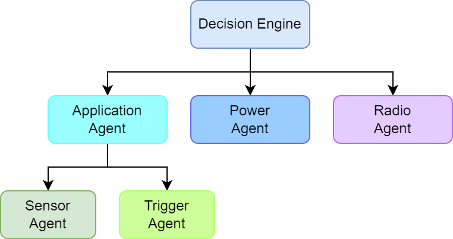
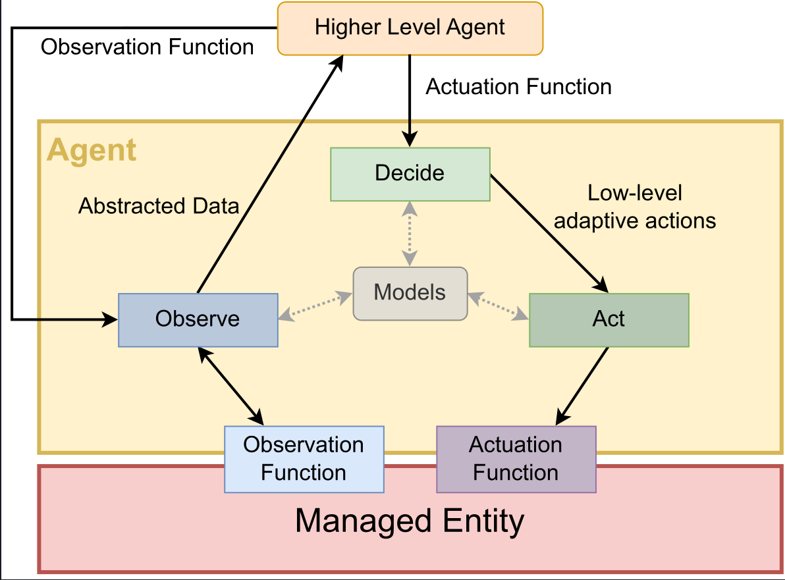

# Self-Aware Sensor Node Architecture
Reference architecture of a self-aware sensor node.

Description Base implementation of a hierarchical, agent-based architecture of a self-aware wireless sensor node. This is not the complete wireless sensor node implementation, but a library that can be ported to an existing codebase to support self-awareness. This architecture was developed to support my Ph.D. Thesis.


The proposed architecture splits the wireless sensor node operation into distinct subtasks (e.g. measurement, wireless transmission, battery management, etc.). Each of these tasks is managed by its own agent, which implements its own Observe-Decide-Act (ODA) loop to monitor and control its assigned task based on its operation requirements. A given task can be split into subtasks also managed by their respective agents creating the hierarchical agent architecture. On the top of the hierarchy lies the Decision agent which is responsible for coordinating the different agents, translating the node level requirements into lower-level agent requirements.

__Reference architecture diagram__



<br>
<br>

__Agent Structure__



## Publications

This reference architecture has been used in different publications and my PhD thesis

* [Arnaiz, David, et al. "Data Relevance-Aware Dynamic Sensing Technique with Battery Lifetime Guarantee for Wireless Sensor Nodes." 2021 XXXVI Conference on Design of Circuits and Integrated Systems (DCIS). IEEE, 2021.](https://ieeexplore.ieee.org/abstract/document/9666191)
* [Arnaiz, David, et al. "Energy and relevance-aware adaptive monitoring method for wireless sensor nodes with hard energy constraints." Integration (2023): 102097.](https://www.sciencedirect.com/science/article/pii/S0167926023001396)
* [__Ph.D. Thesis__: Bringing Self-Awareness to the Extreme Edge - A Distributed Approach for Adaptive Energy Management in WSNs Applied to Structural Health Monitoring"](http://dx.doi.org/10.5821/dissertation-2117-424246)

## Usage
Some tests implementing partial functionality can be seen run.

Navigate to the make directory:
```
cd firmware/make
```

Get help for the makefile:
```
make help
```

List available tests:
```
make list_test
```

Run power agent test:

```
make RUN=true TEST=POWER
```

## Note
This program is distributed in the hope that it will be useful, but WITHOUT
ANY WARRANTY; without even the implied warranty of MERCHANTABILITY or FITNESS
FOR A PARTICULAR PURPOSE.